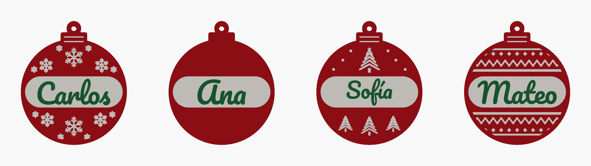

# Esferas navideñas modulares · Ajolote de Bolsillo

Esferas planas de 80 mm: **base de stock** (se imprime por lote) + **nombre aparte** que se pega en el rebaje.
Es un diseño 100% propio (geometría hecha en OpenSCAD desde cero). La fuente es Pacifico, con licencia SIL OFL 1.1 (ver `fuentes/OFL.txt`).



## Archivos

| Archivo | Qué es |
|---|---|
| `esfera_base.scad` | Base paramétrica: 4 variantes (`lisa`, `copos`, `pino`, `rayas`) |
| `nombre.scad` | Pieza del nombre: placa ovalada de 0.6 mm y letras de 2.5 mm |
| `generar.py` | Mide cada nombre, ajusta el tamaño, acomoda la placa y exporta STL, 3MF y vistas previas |
| `salida/bases/` | `base_<variante>.stl` y `base_<variante>_deco.stl` (la incrustación de color) |
| `salida/nombres/` | `nombre_<x>_placa.stl` y `nombre_<x>_letras.stl` |
| `salida/placa_nombres_1.3mf` | Placa de ejemplo: Ana, Carlos, Sofía, Mateo y Valentina |
| `salida/placa_4_bases.3mf` | Las 4 bases en una sola cama, con su deco como pieza aparte |
| `salida/previews/` | Vistas previas PNG |

## Cómo generar nombres nuevos

```bash
python3 generar.py --solo-nombres --nombres "Luis,Ximena,Regina,José Pablo"
```

```bash
python3 generar.py --solo-nombres --archivo pedidos.txt
```

`pedidos.txt` lleva un nombre por renglón. Caben hasta 24 nombres por placa de 260×260 mm. Si hay más, se generan `placa_nombres_2.3mf`, `placa_nombres_3.3mf`, etc.
Requisitos: OpenSCAD y `pip install trimesh numpy networkx lxml`. Para las vistas previas también hace falta `xvfb-run` (Linux).

## Medidas clave

- Disco de Ø80 × 4 mm, con casquillo y argolla. El agujero es de Ø4 mm y la pieza mide 93.5 mm de alto en total.
- El rebaje es un óvalo de 74 × 24 mm y 0.6 mm de profundidad, en la cara visible.
- La placa del nombre mide 73.6 × 23.6 × 0.6 mm: **0.2 mm de holgura por lado**. Las letras sobresalen 2.5 mm.
- El texto se ajusta solo: mide como máximo 66 mm de ancho (el límite pedido era 70) y hasta 20.4 mm de alto. Los nombres cortos salen más grandes.

## Cómo imprimir (Creality Print + CFS)

- **Base:** se imprime **boca abajo**, con la cara visible sobre el PEI texturizado. El STL ya viene espejeado para que la deco quede derecha. No lleva soportes.
- **Deco = incrustación a ras** de 0.6 mm (las primeras 3 capas). Al abrir el 3MF, asigna un filamento a la pieza `base_*` (rojo, verde…) y otro a `deco_*` (blanco o dorado).
  - Si la imprimes en un solo color, la deco queda como grabado táctil. Todos los trazos miden ≤ 2.5 mm, así que el puente es corto.
  - Ojo: con la cara hacia abajo **no se puede hacer un relieve que sobresalga sin soportes**. Por eso la deco va incrustada a ras, que además deja la cara lisa.
- El techo del rebaje del nombre es un puente de 24 mm. Queda oculto bajo la placa; activa "detect bridging" (viene activado por defecto).
- **Nombre:** se imprime con la placa sobre la cama. La placa va en un color y las letras en otro: es **un solo cambio de filamento a z = 0.6 mm**.
- Para pegar, basta una gota de cianoacrilato en gel o pegamento para PLA.
- Paleta sugerida (máx. 4 colores): rojo, verde pino, blanco y dorado. Sin rosa.

## Gramos y tiempos (estimados)

Rebanado con PrusaSlicer 2.7 y un perfil parecido al SparkX i7: capa de 0.2 mm, 2 perímetros, relleno gyroid al 15 %, perímetros a 200 mm/s, relleno a 300 mm/s y flujo máx. de 20 mm³/s.
**Creality Print puede dar ±15 %.** Los tiempos de cambio de color con el CFS (≈1.5 min y ≈1 g de purga por cambio) son una estimación aparte y no se midieron.

| Pieza | Gramos | Tiempo (pieza sola) | Gramos de 2.º color | Piezas por placa |
|---|---|---|---|---|
| Base lisa | 12.9 g | 22 min | — | 4 (≈52 g, 1 h 27 min) |
| Base copos | 13.7 g | 29 min | 0.44 g | 4 |
| Base pino | 13.4 g | 25 min | 0.24 g | 4 |
| Base rayas | 14.1 g | 29 min | 0.55 g | 4 |
| Nombre Ana | 2.2 g | 5 min | 0.89 g (letras) | 24 |
| Nombre Carlos | 2.5 g | 6 min | 1.17 g | 24 |
| Nombre Sofía | 2.0 g | 5 min | 0.72 g | 24 |
| Nombre Mateo | 2.7 g | 7 min | 1.36 g | 24 |
| Nombre Valentina | 2.5 g | 7 min | 1.24 g | 24 (≈58 g, 2 h 40 min) |
| **Placa de ejemplo (5 nombres)** | **11.9 g** | **31 min** | — | 5 |

Cambios de color por placa:
- **Bases decoradas:** unos 4 cambios por placa (capas 1 a 3), da igual cuántas bases lleve. Eso suma ≈ +6 min y ≈ 4 g de purga por placa.
- **Nombres:** 1 cambio por placa, que suma ≈ +1.5 min y ≈ 1 g. Conviene llenar la placa completa.
